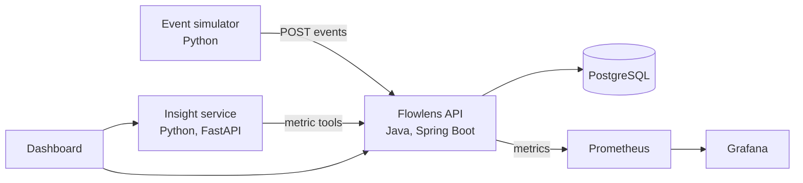

# Flowlens

**Google Maps traffic jams, but for business processes.**

Flowlens follows every order through a small business, shows where orders get stuck, and explains why in plain language.

[](https://github.com/Emantous/flowlens/actions/workflows/ci.yml)
[](https://github.com/Emantous/flowlens/releases)
[](LICENSE)

> **You:** Why were Friday deliveries late?
>
> **Flowlens:** On Fridays, orders wait about 47 minutes before baking starts, compared with 12 minutes on other days. Payment failures are not the cause.


> **Status:** early development. See the [roadmap](#roadmap) for what works today and what is planned.

---

## The problem

A business repeats the same steps again and again: take an order, get paid, make the product, deliver it. When customers complain about slowness, the owner usually knows the total time but not **which step** eats it.

Flowlens answers one question: **where do my orders get stuck, and why?**

This is a small-scale version of *process mining*, the technique behind commercial products such as Celonis and SAP Signavio Process Intelligence, built here to learn how such systems work end to end.

## How it works

1. **Events come in.** Each time something happens to an order ("order paid", "baking started"), a small message is sent to the API.
2. **Trails are built.** Flowlens groups the events by order and reconstructs each order's journey with timestamps.
3. **Waiting is measured.** It calculates the wait before every step, compares days and hours, and flags orders that broke a promise such as "delivered within 90 minutes".
4. **The dashboard shows the result.** A flow diagram highlights the slowest step, a heatmap shows the worst time windows, and a list shows the slowest orders with their trails.
5. **You ask questions in plain language.** The assistant answers using metrics the API has already computed. It does not read raw data and guess, so it cannot invent numbers.

You do not need a real business to try it. A built-in simulator generates a fictional bakery with problems hidden in the data: a Friday oven bottleneck, more payment failures in the evening and one unreliable courier. Your goal is to find them.

## Quick start

Requirements: [Docker](https://docs.docker.com/get-docker/) with Compose.

```bash
git clone https://github.com/Emantous/flowlens.git
cd flowlens
docker compose up
```

Then open:

| Service | URL |
|---|---|
| Dashboard | http://localhost:8080 |
| API documentation (OpenAPI) | http://localhost:8080/swagger-ui.html |
| Grafana | http://localhost:3000 |
| Prometheus | http://localhost:9090 |

The simulator starts automatically and fills the system with a few weeks of bakery orders.

## Architecture



| Component | Responsibility | Technology |
|---|---|---|
| `api` | Receives events, stores them, computes step durations, bottlenecks and late orders | Java 21, Spring Boot, PostgreSQL, Flyway |
| `insight` | Answers plain-language questions by calling the API's metric endpoints as tools | Python, FastAPI, LLM with tool calling |
| `simulator` | Generates realistic bakery events with injectable problems | Python |
| `dashboard` | Shows the flow, heatmap and slowest orders | Static web page with a chart library |
| `observability` | Metrics and dashboards for Flowlens itself | Micrometer, Prometheus, Grafana |

More detail is in [docs/architecture.md](docs/architecture.md).

## API overview

Full documentation is generated from the code (OpenAPI). The main endpoints:

| Method | Endpoint | Purpose |
|---|---|---|
| `POST` | `/api/v1/events` | Ingest an order event |
| `GET` | `/api/v1/orders/{id}/trail` | Full journey of one order |
| `GET` | `/api/v1/metrics/steps` | Average and percentile wait per step |
| `GET` | `/api/v1/metrics/bottlenecks` | Slowest steps, by day and hour |
| `POST` | `/insight/ask` | Ask a question in plain language |

Example event:

```json
{
  "orderId": "1042",
  "step": "BAKING_STARTED",
  "timestamp": "2026-11-20T10:41:00Z"
}
```

## CI/CD

Every change goes through a pull request. `main` is protected, so nothing merges unless the checks pass.

**On every pull request**

| Stage | Tools |
|---|---|
| Format and lint | Spotless, Checkstyle, ruff |
| Unit tests with coverage gate | JUnit, pytest |
| Integration tests against a real database | Testcontainers |
| End-to-end smoke test | Docker Compose, API assertions |
| Code and dependency security | CodeQL, dependency review, gitleaks |
| Container build and vulnerability scan | Docker, Trivy |

**On merge to `main`**

| Stage | Tools |
|---|---|
| Publish image | GitHub Container Registry |
| Sign image | cosign |
| Software bill of materials | Syft (CycloneDX) |
| Versioning and release notes | Semantic versioning, auto-generated notes |
| Post-deploy smoke test | Docker Compose |

Dependabot keeps dependencies and action versions up to date.

## Development

Requirements: JDK 21, Python 3.12+, Docker.

```bash
# API: build and run all tests (unit and integration)
cd api && ./mvnw verify

# Insight service and simulator
cd insight && pip install -r requirements-dev.txt && pytest
cd simulator && pip install -r requirements-dev.txt && pytest

# Full end-to-end check
docker compose -f docker-compose.test.yml up --abort-on-container-exit
```

Commit messages follow [Conventional Commits](https://www.conventionalcommits.org/), which drives versioning and release notes. See [CONTRIBUTING.md](CONTRIBUTING.md) for the workflow.

## Project structure

```
flowlens/
├── api/                 # Java / Spring Boot service
├── insight/             # Python / FastAPI assistant
├── simulator/           # Python event generator
├── dashboard/           # Web page
├── observability/       # Prometheus and Grafana configuration
├── docs/
│   ├── architecture.md
├── .github/workflows/   # CI/CD pipelines
├── docker-compose.yml
└── CONTRIBUTING.md
```

## Roadmap

Work is tracked on the [project board](https://github.com/Emantous/flowlens/projects) in one-week sprints.

- [ ] **Walking skeleton:** minimal API, Dockerfile, CI that runs tests and builds the image
- [ ] **Core:** event ingestion, database, bottleneck metrics, unit and integration tests
- [ ] **Delivery hardening:** security scans, SBOM, image signing, automated releases
- [ ] **Observability:** Prometheus metrics and Grafana dashboards
- [ ] **Dashboard:** flow diagram, heatmap, slowest orders
- [ ] **Assistant:** plain-language questions with an evaluation suite

## Contributing

Issues and pull requests are welcome. Please read [CONTRIBUTING.md](CONTRIBUTING.md) first.

## License

[MIT](LICENSE)