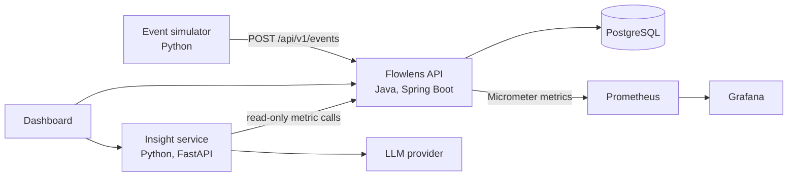
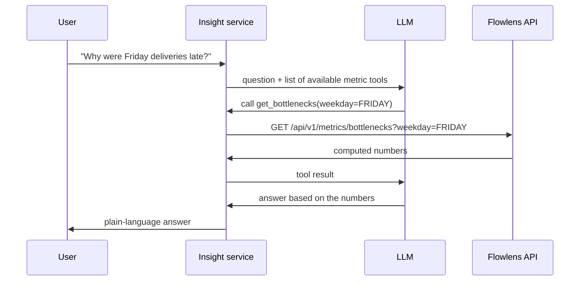

# Flowlens architecture

This document explains how Flowlens is put together and why. For the reasoning behind individual choices, see the [architecture decision records](adr/).

## Overview

Flowlens turns a stream of order events into answers about where orders get stuck.



## Components

| Component | Responsibility | Does not do |
|---|---|---|
| **api** | Validates and stores events, reconstructs order trails, computes metrics, exposes REST endpoints | Talk to the LLM |
| **insight** | Turns a plain-language question into calls to the API's metric endpoints and writes the answer | Access the database or raw events |
| **simulator** | Generates realistic bakery events, including hidden problems | Run in production |
| **dashboard** | Displays flow diagram, heatmap and slowest orders | Contain business logic |
| **observability** | Metrics and dashboards about Flowlens itself | |

## Domain model

A business process is a fixed sequence of steps. The demo bakery uses:

```
ORDER_PLACED -> PAYMENT_CONFIRMED -> BAKING_STARTED -> BAKING_FINISHED
             -> PACKED -> OUT_FOR_DELIVERY -> DELIVERED
```

### Events table

| Column | Type | Notes |
|---|---|---|
| `id` | bigint | Primary key |
| `order_id` | text | Groups events into a trail |
| `step` | text | One of the steps above |
| `occurred_at` | timestamptz | When it happened in the real world |
| `received_at` | timestamptz | When Flowlens received it |
| `attributes` | jsonb | Optional extras, such as courier or payment method |

A unique constraint on `(order_id, step, occurred_at)` makes ingestion idempotent: sending the same event twice has no effect. Schema changes are managed with Flyway migrations.

## Metrics

All metrics are computed from the gaps between consecutive events of the same order.

- **Step wait:** time between one step's event and the next. Reported as average, median (p50) and p95.
- **Bottleneck:** the step transition with the largest wait, grouped by weekday and hour.
- **Late order:** an order whose total time from `ORDER_PLACED` to `DELIVERED` exceeds the service promise (default 90 minutes, configurable).
- **Trail:** the ordered list of events for one order with the wait before each.

Late arrivals are expected. Events are ordered by `occurred_at`, not by `received_at`.

## Ingestion flow

1. A client sends `POST /api/v1/events`.
2. The API validates the payload (known step, timestamp present and not in the future).
3. The event is inserted. Duplicates are ignored.
4. Counters and timers are updated and exposed to Prometheus.

## Assistant flow



Rules the assistant follows:

- It can only call read-only metric tools. It never sees raw events or the database.
- Every number in an answer must come from a tool result.
- If the tools return nothing relevant, it says it does not know.

## Testing strategy

| Level | What it checks | Tools |
|---|---|---|
| Unit | Metric calculations, validation, prompt building | JUnit, pytest |
| Integration | API with a real PostgreSQL | Testcontainers |
| End to end | Simulator to API to metrics, full stack in Compose | Docker Compose |
| Assistant evaluation | Answers match the problems hidden in the simulator | pytest, see [ADR 0004](adr/0004-evaluate-assistant-against-simulator.md) |

## Observability

The API exposes request rates, ingestion counts, error rates and query timings through Micrometer. Prometheus scrapes them and Grafana ships with a provisioned dashboard. Logs are structured JSON and include an order ID where relevant.

## Delivery

Every change goes through a pull request and CI. Merges to `main` publish a signed container image, an SBOM and a versioned release. The pipeline stages are listed in the [README](../README.md#cicd).

## Scaling notes

The demo handles thousands of orders. If it had to handle millions of events, the first steps would be:

- Indexes on `(order_id, occurred_at)` and `(step, occurred_at)`
- Pre-computed aggregates (materialized views or a rollup table) instead of computing metrics per request
- Monthly table partitioning
- A message queue in front of ingestion to absorb bursts

## Non-goals

- Supporting arbitrary, user-defined processes. Flowlens models one fixed process.
- Real-time streaming analytics.
- Multi-tenancy and authentication beyond a simple API key.